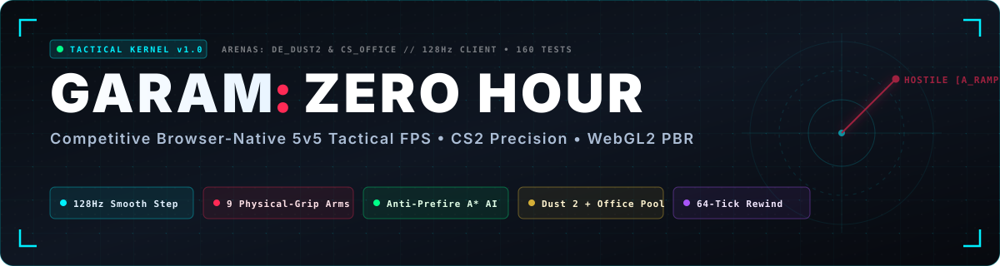
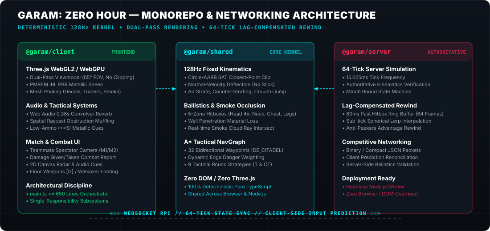
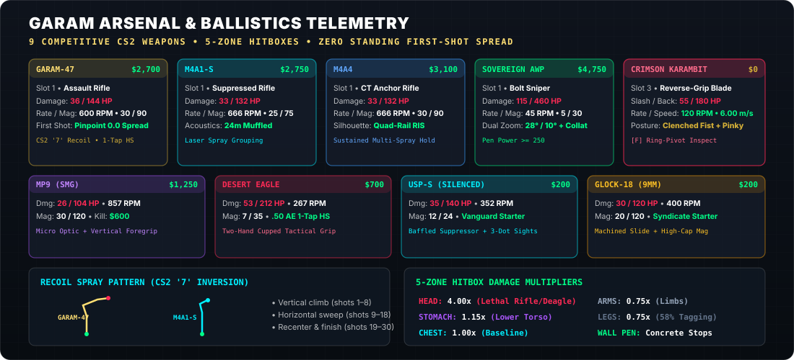

# GARAM: ZERO HOUR — Competitive 5v5 Browser Tactical FPS

<p align="center">
  
</p>

<p align="center">
  <a href="https://github.com/EldarJamiyev/GARAM"></a>
  
  
  
  
</p>

---

## 1. High-Level Vision & Tactical Philosophy

**GARAM: ZERO HOUR** is an authentic, browser-native competitive 5v5 tactical first-person shooter engineered to deliver Counter-Strike 2 mechanical fidelity, sub-millimeter movement responsiveness, and esports visual clarity directly in any modern WebGL2 browser.

- **Lead Operator:** Eldar Garamov (Callsign: Sovereign-1), Supreme Commander of the GARAM Vanguard.
- **The Conflict:** **GARAM Vanguard** (Defenders / CT) vs. **The Obsidian Syndicate** (Attackers / T).
- **Core Directives:**
  1. **Strict 128Hz Kinematic Determinism & Parity:** Pure mathematical kinematics with `STOP_SPEED` Source friction, Circle-AABB Separating Axis Theorem (SAT) wall deflection, overhead ceiling clearance verification, and smooth stair stepping (`stepOffsetY`). Discrete 1/128s server sub-stepping guarantees zero Euler drift between client prediction reconciliation and authoritative server.
  2. **Authoritative Anti-Cheat & Input Hardening:** Ray origin and spread direction are strictly computed server-side from authenticated yaw/pitch, weapon ownership, melee range (`<= 2.4m`), and freeze-time locks. Includes atomic IP connection caps, token-bucket rate limiting (150 msg/s), 2KB payload cap, server-measured `ping_challenge`/`pong_challenge` RTT, and prototype pollution defenses.
  3. **Zero Standing Spread RNG & Pinpoint First-Shot Invariant:** All firearms (`garam-47`, `vanguard-m4`, `desert-eagle`, `sovereign-awp`) enforce `sprayPattern[0] = [0.0, 0.0]`. Stationary shooting (`speed <= 0.38 m/s`) provides 100% deterministic, laser-precise first-shot accuracy directly to the crosshair / optic center, and scoped Sovereign AWP shots evaluate spread with `wasScoped = true` prior to bolt unscope for pinpoint 1-shot lethal torso kills at 30m–60m+.
  4. **A\* Tactical Bot Brain & Persistent Anti-Stuck Evasion:** 100% verified collision-free 32-waypoint tactical navigation graph (>= 0.55m node clearance, >= 0.40m corridor clearance, grounded elevated A Heaven nodes). Incorporates persistent 0.85s wall-tangent sliding evasion, live sound-event awareness, flashbang anti-turn reactions, and smoke-occluded `hasLineOfSight`.
  5. **Dual-Pass PBR Rendering & Zero-Stall WebGL Pipeline:** Depth-isolated viewmodel rendering (65° FOV) with Poly Haven CC0 HDR skybox and procedural PMREM Image-Based Lighting (IBL) reflections, zero world-geometry clipping, instanced horizon skyline & 3D brass shell casings, dirty-flagged HUD/billboard updates, and zero `backdrop-filter` compositing stalls.
  6. **Adaptive Clock-Skew Immune Lag Compensation:** Authoritative 64-tick server simulation with server-measured half-RTT hitbox rewind (preserving crouched posture and shortest-arc yaw interpolation) and Binary Protocol v2 (`36 + 29*N` bytes with collision-free `entitySlot`, live ammo, and bomb plant/defuse progress).
  7. **Clean-Room Tactical Bot Archetypes & Radio Comms:** 10 distinct personality archetypes (Maverick, Steel, Hawk, Aegis, Sentinel, Viper, Ghost, Razor, Titan, Nomad) with dynamic reaction times, slew rates, skill-based spray control, ElevenLabs weapon audio samples, and procedural dual-tone radio squelch DSP.

---

## 2. Monorepo & System Architecture

<p align="center">
  
</p>

The project is structured as an npm workspaces monorepo enforcing strict boundaries:

- **`@garam/shared`**: Pure, deterministic TypeScript kernel with **zero DOM or Three.js dependencies**. Implements 128Hz kinematics, `SpatialGrid` broad-phase acceleration, Circle-AABB SAT collision resolution, 5-zone raycast ballistics with opaque cover & inside-smoke LOS occlusion, the 32-node `TacticalNavGraph` with A\* pathfinding, MR12 CS2 economy rules, Binary Protocol v2 codecs, and `MatchSimulation`.
- **`@garam/client`**: Client application running Three.js (WebGL2), dual-pass viewmodels, procedural PMREM IBL materials, Web Audio DSP convolver reverb + sampled weapon acoustics, LOS-spotted 2D radar, dropped weapon physics, spectator system, instanced volumetric smoke VFX, deterministic client prediction reconciliation, and lean orchestrator (`main.ts <= 320 lines`).
- **`@garam/server`**: Authoritative 64-tick Node.js server running shared physics verification, crouch/yaw-aware historical hitbox rewind, authoritative buy/reload/utility/plant-defuse simulation, live smoke-occluded PVS, dynamic RoomRegistry, and backpressure-guarded snapshot streaming.

---

## 3. DE_CITADEL — Tactical Map Blueprint

<p align="center">
  
</p>

`DE_CITADEL` is a tournament-grade 120m x 120m three-lane competitive defusal map designed for 5v5 tactical engagements:

- **Bombsite A (Armory Vault):** Wide exterior lane with long-range rifle sightlines, elevated `A Heaven` balcony, high-ground stairs, and quick rotation through `A Connector`.
- **Bombsite B (Reactor Vault):** Close-quarters industrial zone with blue/red cargo containers, acoustic concrete `B Tunnels` (0.38s convolver reverb), and `B Connector` rotation.
- **Mid Courtyard:** Crucial tactical hub connecting both spawns with double doors, sniper sightlines, and split execution lanes.
- **Dynamic 11-Zone Callout HUD:** Real-time spatial tracking (`CT SPAWN`, `T SPAWN`, `A SITE`, `A LONG`, `A HEAVEN`, `A CONNECTOR`, `B SITE`, `B MAIN`, `B TUNNELS`, `B CONNECTOR`, `MID COURTYARD`).

---

## 4. Competitive Arsenal & Ballistics

<p align="center">
  
</p>

### Weapon Specifications & CS2 Recoil Patterns

| Weapon | Slot | Cost | Damage (Body / Head) | RPM | Mag / Reserve | Unique Mechanical Features |
| :--- | :---: | :---: | :---: | :---: | :---: | :--- |
| **Garam-47** | 1 | $2,700 | 36 / 144 HP | 600 | 30 / 90 | CS2 '7' recoil spray curve, 1-shot headshot kill, authentic curved banana magazine. |
| **Vanguard M4A1-S** | 1 | $2,750 | 33 / 132 HP | 666 | 25 / 75 | Perforated suppressor, 11m muffled gunshot radius, tight laser spray grouping. |
| **Sovereign AWP** | 1 | $4,750 | 115 / 460 HP | 45 | 5 / 30 | 1-shot lethal torso kill, dual-stage 28°/10° optical zoom, flared scope with emerald tint. |
| **Desert Eagle** | 2 | $700 | 53 / 212 HP | 267 | 7 / 35 | Heavy handgun pocket cannon, serrated cocking slide, lethal 1-shot headshot at close/mid. |
| **Crimson Karambit** | 3 | $0 | 55 / 55 (180 Backstab) | — | 1 / 0 | True `ExtrudeGeometry` curved hawkbill blade, 360° ring-spin draw `[3]`/`[Q]`, `[F]` inspect twirl. |

### 5-Zone Raycast Ballistics Multipliers
- **Head (`HEAD`):** 4.00x multiplier (Instant lethal rifle/sniper hit)
- **Chest (`CHEST`):** 1.00x baseline damage
- **Stomach (`STOMACH`):** 1.15x multiplier
- **Arms & Hands (`ARMS`):** 0.75x multiplier
- **Legs & Feet (`LEGS`):** 0.75x multiplier (Applies 58% tagging deceleration)

---

## 5. Controls & Keybindings Reference

| Action | Primary Input | Secondary / Alternate | Notes |
| :--- | :---: | :---: | :--- |
| **Move Forward / Back / Strafe** | `W`, `S`, `A`, `D` | — | 128Hz fixed kinematics with instant counter-strafing. |
| **Jump / Crouch-Jump** | `Space` | — | Air strafing enabled (`wishDir` acceleration). |
| **Crouch (Duck)** | `ControlLeft` | — | Smooth eye height transition ($1.72\text{m} \to 1.16\text{m}$). |
| **Walk (Silent Movement)** | `ShiftLeft` | — | Restricts speed to $3.30\text{m/s}$, eliminates all footstep audio cues. |
| **Primary Fire / Slash** | `Mouse 1 (Left)` | — | Automatic or semi-auto fire / Karambit alternating slashes. |
| **Secondary Fire / Scope / Stab** | `Mouse 2 (Right)` | — | AWP dual-stage zoom / Karambit heavy hook thrust. |
| **Reload Weapon** | `R` | — | Full animation timer with ammo reserve replenishment. |
| **Quick Switch Weapon** | `Q` | — | Instantly flips to previous weapon slot with draw animation. |
| **Weapon Slot Selection** | `1`, `2`, `3`, `4`, `5` | `Scroll Wheel` | Primary (1), Secondary (2), Knife (3), Utility (4), Bomb (5). |
| **Grenade Quick-Select** | `Z`, `X`, `C`, `V` | — | Smoke (Z), Flash (X), HE Grenade (C), Molotov (V). |
| **Drop Active Weapon** | `G` | — | Tosses active firearm into 3D world with physical drop arc. |
| **Interact / Defuse / Loot Floor** | `E` | — | Hold to defuse (5s kit, 10s raw) or press aiming at dropped weapon. |
| **Inspect Weapon & Knife Spin** | `F` | — | Continuous CS2 finger-ring spin on Karambit, sway inspect on guns. |
| **Tactical Buy Menu** | `B` | — | Available in buy zones during freeze time or first 20s. |
| **Performance Monitor Overlay** | `F3` | — | Real-time FPS, frame time, latency, draw calls, triangles. |
| **Sandbox Customizer Panel** | `F2` | — | Live crosshairs, infinite ammo, bot freeze, and practice cash. |
| **Scoreboard / Combat Status** | `Tab` | — | Displays live player stats, K/D/A, ping, and bot rosters. |
| **Spectator Teammate Cycle** | `Mouse 1` / `Mouse 2` | — | Active on death to spectate living allies in third-person. |

---

## 6. Development Roadmap & Verification

<p align="center">
  
</p>

### Test Suite Coverage (117 Passing Tests Across 16 Suites)
Run the automated test suite across all packages:
```bash
npm test
```
```text
 ✓ packages/client/src/__tests__/client-systems.test.ts       (6 tests)
 ✓ packages/server/src/__tests__/gameroom.integration.test.ts (6 tests)
 ✓ packages/server/src/__tests__/pvs.test.ts                  (1 test)
 ✓ packages/server/src/__tests__/registry.test.ts             (6 tests)
 ✓ packages/shared/src/__tests__/botprofiles.test.ts          (3 tests)
 ✓ packages/shared/src/__tests__/kinematics.test.ts          (13 tests)
 ✓ packages/shared/src/__tests__/ballistics.test.ts          (23 tests)
 ✓ packages/shared/src/__tests__/simulation.test.ts           (8 tests)
 ✓ packages/shared/src/__tests__/spatial.test.ts              (3 tests)
 ✓ packages/shared/src/__tests__/binarycodec.test.ts          (4 tests)
 ✓ packages/shared/src/__tests__/security.test.ts             (6 tests)
 ✓ packages/shared/src/__tests__/lagcomp.test.ts              (7 tests)
 ✓ packages/shared/src/__tests__/navgraph.test.ts            (14 tests)
 ✓ packages/shared/src/__tests__/callout.test.ts              (9 tests)
 ✓ packages/shared/src/__tests__/economy.test.ts              (5 tests)
 ✓ packages/shared/src/__tests__/docs-sync.test.ts            (3 tests)

 Test Files  16 passed (16)
      Tests  117 passed (117)
```

---

## 7. Quick Start & Developer Guide

### Prerequisites
- Node.js >= 18.0.0
- npm >= 9.0.0

### Installation & Launch
```bash
# Clone the repository
git clone https://github.com/EldarJamiyev/GARAM.git
cd GARAM

# Install monorepo dependencies
npm install

# Verify TypeScript across all workspaces (0 errors required)
npm run typecheck

# Execute unit and integration tests
npm test

# Build all packages
npm run build

# Start the local development server (Client on http://localhost:3000)
npm run dev
```

Alternatively, on Windows, double-click **`PLAY_GARAM.bat`** in the project root for one-click launch.

---

## 8. License & Credits

Built with precision by **Eldar Jamiyev** & the GARAM Systems Team.  
All gameplay systems, deterministic kinematics, and architectural specifications are maintained under the MIT License.
