# GARAM: ZERO HOUR — Competitive 5v5 Browser Tactical FPS

<p align="center">
  
</p>

<p align="center">
  <a href="https://github.com/EldarJamiyev/GARAM"></a>
  
  
  
  
</p>

---

## 1. High-Level Vision & Tactical Philosophy

**GARAM: ZERO HOUR** is an authentic, browser-native competitive 5v5 tactical first-person shooter engineered to deliver Counter-Strike 2 mechanical fidelity, sub-millimeter movement responsiveness, and esports visual clarity directly in any modern WebGL2 browser.

- **Lead Operator:** Eldar Garamov (Callsign: Sovereign-1), Supreme Commander of the GARAM Vanguard.
- **The Conflict:** **GARAM Vanguard** (Defenders / CT) vs. **The Obsidian Syndicate** (Attackers / T).
- **Core Directives:**
  1. **Strict 128Hz Kinematic Determinism & CS2 Smooth Step Traversal:** Pure mathematical kinematics with `STOP_SPEED` Source friction, `SpatialGrid` broadphase acceleration, Circle-AABB Separating Axis Theorem (SAT) wall deflection, overhead ceiling clearance verification, air-strafe speed capping, lowest-riser CS2 step-up / downhill step-down grounding, and bidirectional `stepOffsetY` camera smoothing. Discrete 1/128s server sub-stepping and full `KinematicSnapshot` reconciliation guarantee zero Euler drift between client prediction and authoritative server.
  2. **Authoritative Anti-Cheat & Input Hardening:** Ray origin, deterministic PRNG spread (`BallisticsSpread`), per-weapon fire cooldowns, 180ms weapon-deploy lockouts, and bomb plant/defuse ownership mutexes are strictly enforced server-side. Includes atomic IP connection caps, smooth token-bucket rate limiting, trusted proxy hop parsing, strict production `Origin` validation, 2KB payload caps, full-RTT `ping_challenge`/`pong_challenge` verification, and recursive prototype-pollution defenses.
  3. **Zero Standing Spread RNG & Pinpoint First-Shot Invariant:** All primary rifles and pistols (`garam-47`, `vanguard-m4`, `m4a4`, `sovereign-awp`, `desert-eagle`, `usp-s`, `glock-18`) enforce `sprayPattern[0] = [0.0, 0.0]` with full magazine-length recoil arrays. Stationary shooting (`speed <= 0.38 m/s`) provides 100% deterministic, laser-precise first-shot accuracy, and scoped Sovereign AWP shots support high-penetration collateral hits (`penetrationPower >= 250`).
  4. **Human-Perception Tactical Bot AI (Zero Prefires & Counter-Strafe Footwork):** Collision-free tactical waypoint & nav-graph patrolling across both `DE_DUST2 (A-SITE)` and `CS_OFFICE (2-SITE)` (spawned facing down active choke corridors along `wp0 → wp1`), forward-FOV visual perception, peripheral/distance/surprise reaction latencies, strict crosshair-alignment firing gates (shots fire strictly along actual slewed yaw/pitch with realistic moving-target tracking lag), counter-strafed burst-and-strafe combat footwork, cover retreats on reload/low HP, tactical choke angle-holding with corner-slicing crosshair placement, deadlock-free corridor passing, flashbang blindness & smooth anti-flash turns, live mid-match difficulty re-scaling, and smoke-occluded `hasLineOfSight`.
  5. **Dual-Pass PBR Rendering, Physical Finger Gripping & Zero-Overlap HUD (`60°–66°` FOV):** Depth-isolated viewmodel rendering (`60°` desktop FOV, gently clamped up to `66°` on narrow/portrait screens, `0.05m` near plane) with unified CS2 Rigify first-person arms (`cs2_fps_arms.glb`), biomechanical curled finger phalanges (closed fist gripping the **Crimson Karambit** handle/ring + two-handed pistol and forend rifle grips), faction-tinted tactical gloves (**Vanguard CT** navy-slate vs. **Syndicate T** crimson-obsidian with natural bare forearm skin), automated dual-viewport (`1440×900` & `430×932`) skinned-vertex posture verification across `Idle`, `Fire`, `Reload`, `Draw`, and `Inspect` (`0` visible bicep cutoffs, elbows off bottom edge, rifle buttstocks tucked into the shoulder pocket, `0` crosshair occlusion), full 9-weapon CS2 arsenal (`garam-47`, `vanguard-m4`, `m4a4`, `mp9`, `sovereign-awp`, `desert-eagle`, `usp-s`, `glock-18`, `garam-karambit`), rigged 3P skeletal operators (`operator_vanguard.glb`, `operator_syndicate.glb`) with depth-tested dark-pill nameplates, live top-down orthographic radar baking, zero-overlap responsive HUD/Lobby (`#killfeed`, `#slot-bar`, mid-width/mobile layouts, `[?] CONTROLS` modal), and non-sticky `AUTO` graphics governance.
  6. **Shared `MapRegistry` & Adaptive Clock-Skew Immune 64-Tick Netcode:** Both client and authoritative 64-tick `GameRoom.ts` resolve map colliders, spawn points, buy zones, bombsites, and bot patrol routes through a single shared `MapRegistry` (`mapId` handshake on `join`/`welcome`), eliminating online server-client map desync alongside 64-slot ring-buffer `O(1)` half-RTT hitbox rewind, Int16-clamped Binary Protocol v2 (`36 + 29*N` bytes), and 2×128Hz batched binary inputs (`0x03`, 41 bytes).
  7. **Authoritative Utility Physics & MR12 Halftime Rules:** Shared `UtilitySimulation` steps server-side bouncing grenade arcs with sloped voxel ramp-lip deflection, active `MapBounds`, LOS-occluded HE blast waves, and smoke-extinguishable 40 DPS Molotov zones alongside automatic MR12 Round 13 halftime side-swap and `$800` pistol-round resets.

---

## 2. Monorepo & System Architecture

<p align="center">
  
</p>

The project is structured as an npm workspaces monorepo enforcing strict boundaries:

- **`@garam/shared`**: Pure, deterministic TypeScript kernel with **zero DOM or Three.js dependencies**. Implements 128Hz kinematics with `KinematicSnapshot`, `SpatialGrid` zero-alloc broad-phase acceleration, Circle-AABB SAT collision resolution, 5-zone raycast ballistics with AWP collaterals & `BallisticsSpread`, `UtilitySimulation` grenade/HE/Molotov physics, shared `MapRegistry` (`de_dust2` & `cs_office` descriptors), `TacticalNavGraph`, MR12 CS2 economy & halftime rules, Binary Protocol v2 + batched input (`0x03`) codecs, recursive `Validator`, and `MatchSimulation`.
- **`@garam/client`**: Client application running Three.js (WebGL2), dual-pass `60°–66°` CS2 viewmodels with faction-tinted gloves, procedural PMREM IBL materials, Web Audio DSP convolver reverb + sampled weapon acoustics, top-down orthographic baked 2D radar, wall-deflecting dropped weapon physics, XSS-safe spectator system, pooled DOM/GPU combat VFX, lazy-loaded `CustomizerUI`, batched binary prediction reconciliation, and lean orchestrator (`main.ts <= 320 lines`).
- **`@garam/server`**: Authoritative 64-tick Node.js server running shared `MapRegistry` physics verification, ring-buffer crouch/yaw-aware historical hitbox rewind, authoritative buy/reload/utility/plant-defuse simulation with mutexes, 5v5 bot takeover & patrolling, live smoke-occluded PVS, cryptographic `RoomRegistry`, token-bucket rate limiting, and backpressure-guarded snapshot streaming.

---

## 3. Competitive Arena Pool (`MapRegistry`: `DE_DUST2` & `CS_OFFICE`)

<p align="center">
  
</p>

Players can switch maps live in the Lobby (`MAP` selector) or synchronize automatically via the 64-tick multiplayer `join`/`welcome` handshake:

1. **`DE_DUST2 (A-SITE)` (`de_dust2`, Default):**
   - High-fidelity Counter-Strike 2 Dust 2 A-Site Wing GLB (`packages/client/public/models/de_dust2.glb`) paired with **271 precomputed AABB colliders** (`DeDust2Data.ts`) and real-time Lobby progress streaming.
   - Covers **CT Spawn**, **A Ramp**, **Bombsite A**, **A Pit**, **A Car**, **A Long Doors**, and **A Short Catwalk** for rapid 5v5 A-Site executes and retakes.
2. **`CS_OFFICE (2-SITE)` (`cs_office`, Full 2-Site Rotation):**
   - Full two-level snowy corporate office complex (`CsOfficeData.ts`, `84m × 76m`) with **Bombsite A (Executive Boardroom)** and **Bombsite B (Loading Dock / Server Wing)**, Front Courtyard, Garage, Main Hall, Breakroom, Side Hall, Stairwell, Paper Storage, and Sniper Window overlooks for macro 2-site rotations and fake executes.

---

## 4. Competitive Arsenal & Ballistics (9 CS2 Weapons)

<p align="center">
  
</p>

### Weapon Specifications & CS2 Recoil Patterns

| Weapon | Slot | Cost | Damage (Body / Head) | RPM | Mag / Reserve | Unique Mechanical Features |
| :--- | :---: | :---: | :---: | :---: | :---: | :--- |
| **Garam-47** | 1 | $2,700 | 36 / 144 HP | 600 | 30 / 90 | CS2 '7' recoil spray curve, 1-shot headshot kill, authentic curved banana magazine. |
| **Vanguard M4A1-S** | 1 | $2,750 | 33 / 132 HP | 666 | 25 / 75 | Perforated suppressor, muffled 24m acoustic radius, tight laser spray grouping. |
| **M4A4** | 1 | $3,100 | 33 / 132 HP | 666 | 30 / 90 | Full 30-round STANAG magazine CT rifle for sustained multi-target site anchor holds. |
| **MP9** | 1 | $1,250 | 26 / 104 HP | 857 | 30 / 120 | High-mobility force-buy SMG (`$600` kill reward) with blistering 857 RPM CQC fire rate. |
| **Sovereign AWP** | 1 | $4,750 | 115 / 460 HP | 45 | 5 / 30 | 1-shot lethal torso kill, dual-stage 28°/10° optical zoom, high-penetration collaterals. |
| **Desert Eagle** | 2 | $700 | 53 / 212 HP | 267 | 7 / 35 | Heavy `.50 AE` pocket cannon, serrated cocking slide, lethal 1-shot headshot at close/mid. |
| **USP-S** | 2 | $200 | 35 / 140 HP | 352 | 12 / 24 | Tactical suppressed CT sidearm with crisp first-shot accuracy and low recoil kick. |
| **Glock-18** | 2 | $200 | 30 / 120 HP | 400 | 20 / 120 | High-capacity 20-round Syndicate sidearm built for fast entry pacing. |
| **Crimson Karambit** | 3 | $0 | 55 / 55 (180 Backstab) | 120 | 1 / 0 | Curved hawkbill blade in authentic CS2 dual-hand bottom-edge CQC posture with `[F]` ring spin. |

### 5-Zone Raycast Ballistics Multipliers
- **Head (`HEAD`):** 4.00x multiplier (Instant lethal rifle/sniper hit)
- **Chest (`CHEST`):** 1.00x baseline damage
- **Stomach (`STOMACH`):** 1.15x multiplier
- **Arms & Hands (`ARMS`):** 0.75x multiplier
- **Legs & Feet (`LEGS`):** 0.75x multiplier (Applies 58% tagging deceleration)

---

## 5. Controls & Keybindings Reference

| Action | Primary Input | Secondary / Alternate | Notes |
| :--- | :---: | :---: | :--- |
| **Move Forward / Back / Strafe** | `W`, `S`, `A`, `D` | — | 128Hz fixed kinematics with instant counter-strafing. |
| **Jump / Crouch-Jump** | `Space` | — | Air strafing enabled (`wishDir` acceleration). |
| **Crouch (Duck)** | `ControlLeft` | — | Smooth eye height transition ($1.72\text{m} \to 1.16\text{m}$). |
| **Walk (Silent Movement)** | `ShiftLeft` | — | Restricts speed to $3.30\text{m/s}$, eliminates all footstep audio cues. |
| **Primary Fire / Slash** | `Mouse 1 (Left)` | — | Automatic or semi-auto fire / Karambit alternating slashes. |
| **Secondary Fire / Scope / Stab** | `Mouse 2 (Right)` | — | AWP dual-stage zoom / Karambit heavy hook thrust. |
| **Reload Weapon** | `R` | — | Full animation timer with ammo reserve replenishment. |
| **Quick Switch Weapon** | `Q` | — | Instantly flips to previous weapon slot with draw animation. |
| **Weapon Slot Selection** | `1`, `2`, `3`, `4`, `5` | `Scroll Wheel` | Primary (1), Secondary (2), Knife (3), Utility (4), Bomb (5). |
| **Grenade Quick-Select** | `Z`, `X`, `C`, `V` | — | Smoke (Z), Flash (X), HE Grenade (C), Molotov (V). |
| **Drop Active Weapon** | `G` | — | Tosses active firearm into 3D world with physical drop arc. |
| **Interact / Defuse / Loot Floor** | `E` | — | Hold to defuse (5s kit, 10s raw) or press aiming at dropped weapon. |
| **Inspect Weapon & Knife Spin** | `F` | — | Continuous CS2 finger-ring spin on Karambit, sway inspect on guns. |
| **Tactical Buy Menu** | `B` | — | Available in buy zones during freeze time or first 20s. |
| **Performance Monitor Overlay** | `F3` | — | Real-time FPS, frame time, latency, draw calls, triangles. |
| **Sandbox Customizer Panel** | `F2` | — | Live crosshairs, infinite ammo, bot freeze, and practice cash. |
| **Scoreboard / Combat Status** | `Tab` | — | Displays live player stats, K/D/A, ping, and bot rosters. |
| **Spectator Teammate Cycle** | `Mouse 1` / `Mouse 2` | — | Active on death to spectate living allies in third-person. |

---

## 6. Development Roadmap & Verification

<p align="center">
  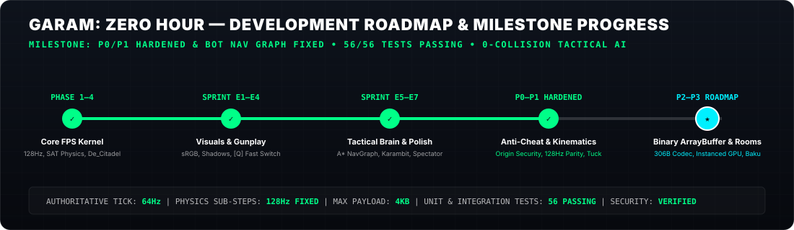
</p>

### Test Suite Coverage (160 Passing Tests Across 20 Suites)
Run the automated test suite across all packages:
```bash
npm test
```
```text
 ✓ packages/client/src/__tests__/client-systems.test.ts       (13 tests)
 ✓ packages/client/src/__tests__/viewmodel-rig.test.ts        (10 tests)
 ✓ packages/client/src/__tests__/operator-rig.test.ts         (1 test)
 ✓ packages/server/src/__tests__/gameroom.integration.test.ts (9 tests)
 ✓ packages/server/src/__tests__/pvs.test.ts                  (1 test)
 ✓ packages/server/src/__tests__/registry.test.ts             (6 tests)
 ✓ packages/shared/src/__tests__/botai.test.ts                (9 tests)
 ✓ packages/shared/src/__tests__/botprofiles.test.ts          (3 tests)
 ✓ packages/shared/src/__tests__/kinematics.test.ts           (16 tests)
 ✓ packages/shared/src/__tests__/ballistics.test.ts           (26 tests)
 ✓ packages/shared/src/__tests__/simulation.test.ts           (11 tests)
 ✓ packages/shared/src/__tests__/spatial.test.ts              (3 tests)
 ✓ packages/shared/src/__tests__/binarycodec.test.ts          (6 tests)
 ✓ packages/shared/src/__tests__/security.test.ts             (7 tests)
 ✓ packages/shared/src/__tests__/lagcomp.test.ts              (8 tests)
 ✓ packages/shared/src/__tests__/navgraph.test.ts             (12 tests)
 ✓ packages/shared/src/__tests__/callout.test.ts              (5 tests)
 ✓ packages/shared/src/__tests__/dedust2.test.ts              (6 tests)
 ✓ packages/shared/src/__tests__/economy.test.ts              (5 tests)
 ✓ packages/shared/src/__tests__/docs-sync.test.ts            (3 tests)

 Test Files  20 passed (20)
      Tests  160 passed (160)
```

---

## 7. In-Engine Gameplay & Visual Telemetry

The screenshots below are captured directly from live headless Chrome WebGL2 playtests at 1440×900 via `scripts/visual-audit.cjs`, demonstrating the Source 2 optical pipeline, 6 photographic PBR texture sets, procedural architecture, and unified viewmodel rig:

<p align="center">
  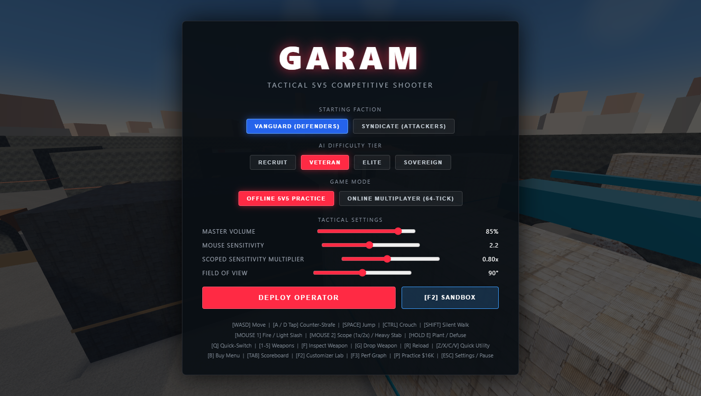
  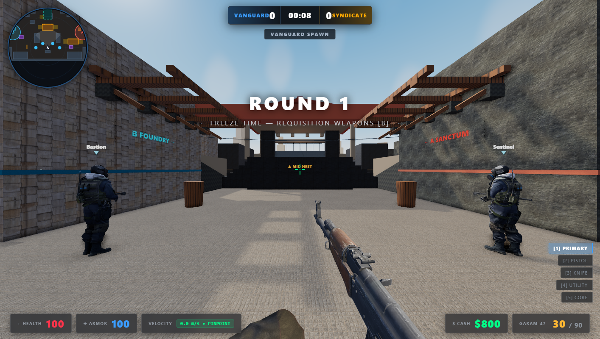
</p>
<p align="center">
  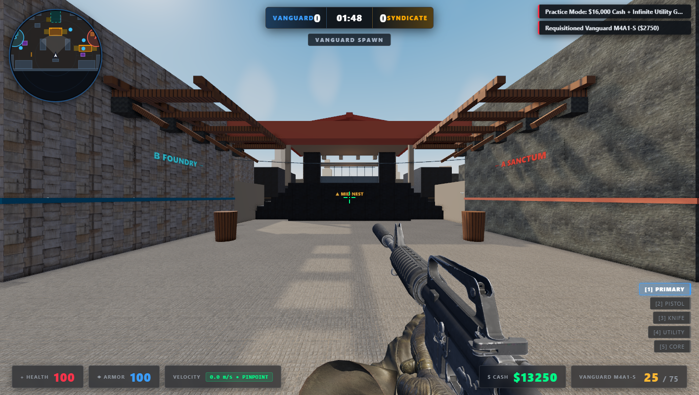
  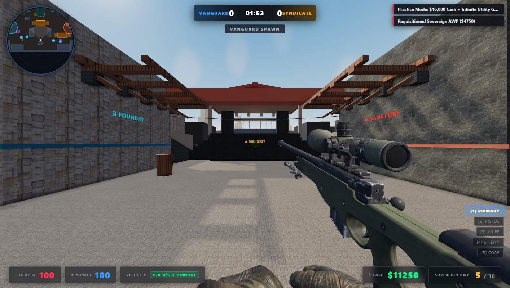
</p>
<p align="center">
  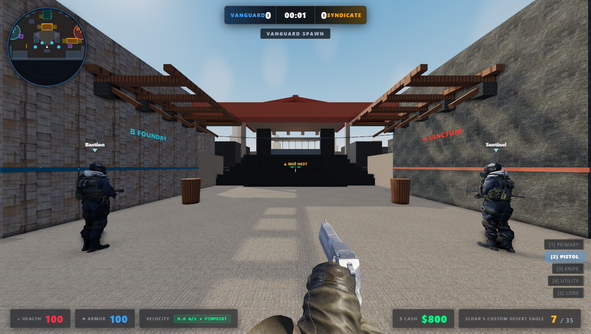
  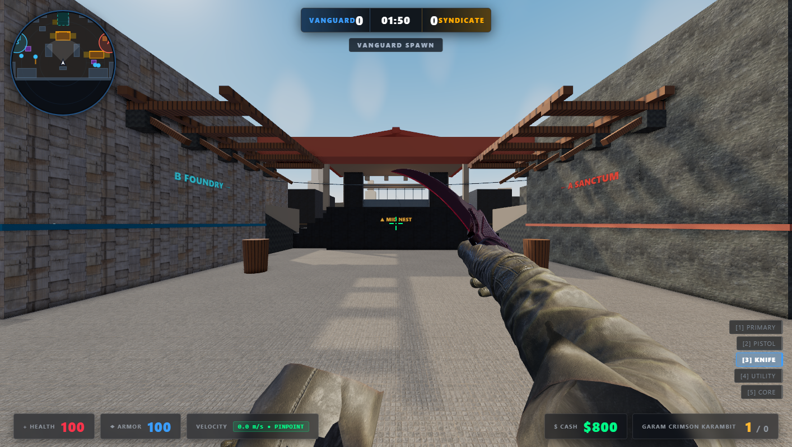
</p>
<p align="center">
  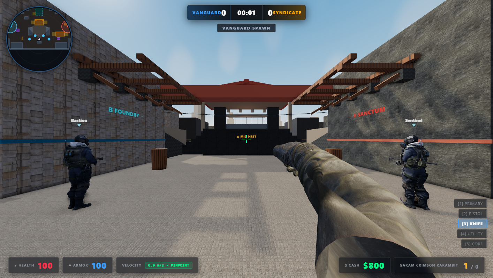
  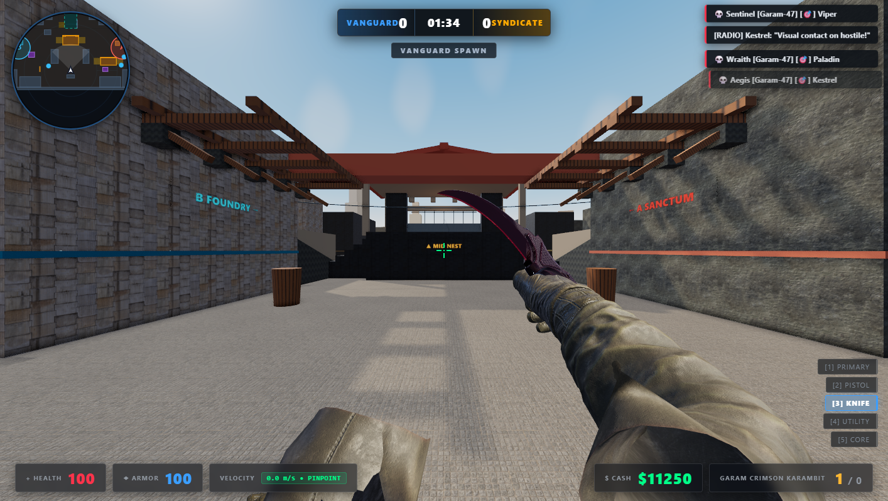
</p>
<p align="center">
  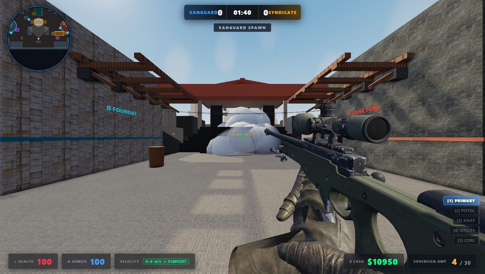
  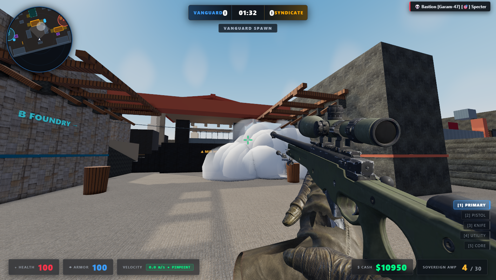
</p>

---

## 8. Quick Start & Developer Guide

### Prerequisites
- Node.js >= 18.0.0
- npm >= 9.0.0

### Installation & Launch
```bash
# Clone the repository
git clone https://github.com/EldarJamiyev/GARAM.git
cd GARAM

# Install monorepo dependencies
npm install

# Verify TypeScript across all workspaces (0 errors required)
npm run typecheck

# Execute unit and integration tests
npm test

# Build all packages
npm run build

# Start the local development server (Client on http://localhost:3000)
npm run dev
```

Alternatively, on Windows, double-click **`PLAY_GARAM.bat`** in the project root for one-click launch.

---

## 9. License & Credits

Built with precision by **Eldar Jamiyev** & the GARAM Systems Team.  
All gameplay systems, deterministic kinematics, and architectural specifications are maintained under the MIT License.
