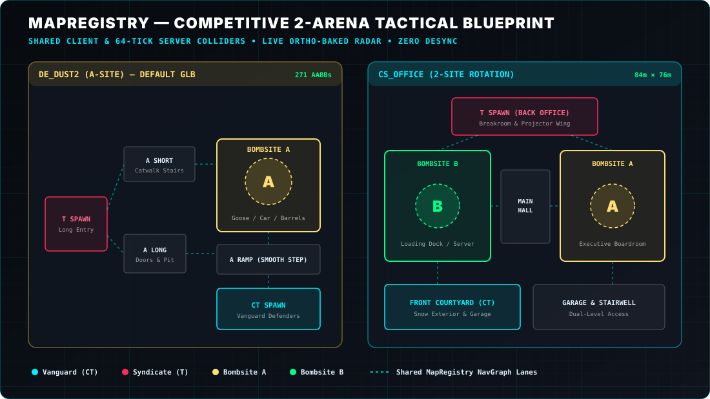

# GARAM: ZERO HOUR — Competitive 5v5 Browser Tactical FPS

<p align="center">
  
</p>

<p align="center">
  <a href="https://github.com/EldarJamiyev/GARAM"></a>
  
  
  
  
</p>

---

## 1. High-Level Vision & Tactical Philosophy

**GARAM: ZERO HOUR** is an authentic, browser-native competitive 5v5 tactical first-person shooter engineered to deliver Counter-Strike 2 mechanical fidelity, sub-millimeter movement responsiveness, and esports visual clarity directly in any modern WebGL2 browser.

- **Lead Operator:** Eldar Garamov (Callsign: Sovereign-1), Supreme Commander of the GARAM Vanguard.
- **The Conflict:** **GARAM Vanguard** (Defenders / CT) vs. **The Obsidian Syndicate** (Attackers / T).
- **Core Directives:**
  1. **Strict 128Hz Kinematic Determinism & Parity:** Pure mathematical kinematics with `STOP_SPEED` Source friction, `SpatialGrid` broadphase acceleration, Circle-AABB Separating Axis Theorem (SAT) wall deflection, overhead ceiling clearance verification, air-strafe speed capping, and clamped smooth stair stepping (`stepOffsetY`). Discrete 1/128s server sub-stepping and full `KinematicSnapshot` reconciliation guarantee zero Euler drift between client prediction and authoritative server.
  2. **Authoritative Anti-Cheat & Input Hardening:** Ray origin, deterministic PRNG spread (`BallisticsSpread`), per-weapon fire cooldowns, 180ms weapon-deploy lockouts, and bomb plant/defuse ownership mutexes are strictly enforced server-side. Includes atomic IP connection caps, smooth token-bucket rate limiting, trusted proxy hop parsing, strict production `Origin` validation, 2KB payload caps, full-RTT `ping_challenge`/`pong_challenge` verification, and recursive prototype-pollution defenses.
  3. **Zero Standing Spread RNG & Pinpoint First-Shot Invariant:** All firearms (`garam-47`, `vanguard-m4`, `desert-eagle`, `sovereign-awp`) enforce `sprayPattern[0] = [0.0, 0.0]` with full magazine-length recoil arrays. Stationary shooting (`speed <= 0.38 m/s`) provides 100% deterministic, laser-precise first-shot accuracy, and scoped Sovereign AWP shots support high-penetration collateral hits (`penetrationPower >= 250`).
  4. **Human-Perception Tactical Bot AI (Zero Prefires & Counter-Strafe Footwork):** 100% verified collision-free 51-waypoint 3-tier tactical navigation graph (>= 0.55m node clearance, >= 0.40m corridor clearance, zero dead-end nodes, bidirectional stair loops across Underpass `0.0m`, Main Deck `+2.1m`, and 4 Overlooks `+4.9m`) paired with forward-FOV visual perception, peripheral/distance/surprise reaction latencies, strict crosshair-alignment firing gates (shots fire strictly along actual slewed yaw/pitch with realistic moving-target tracking lag), counter-strafed burst-and-strafe combat footwork, cover retreats on reload/low HP, tactical choke angle-holding with corner-slicing crosshair placement, deadlock-free corridor passing, flashbang blindness & smooth anti-flash turns, live mid-match difficulty re-scaling, and smoke-occluded `hasLineOfSight`.
  5. **Dual-Pass PBR Rendering & Unified CS2 3D Asset Pipeline:** Depth-isolated viewmodel rendering (65° FOV) with warm Mediterranean golden-hour lighting, `DE_MERIDIAN` three-quadrant procedural PBR architecture (warm travertine Sanctum A, cool basalt Sunken Aqueduct Mid, brushed steel/cobalt Foundry B with amber interior fixtures, `mergeGeometries` batching, 1.65m crosshair cornice bands, and 4-sided grounded contact AO strips), leak-free PMREM render-target disposal, zero world-geometry clipping, unified CC-BY-4.0 rigged tactical gloved FPS arms (`fps_arms_tactical.glb` driving 28 skeletal `AnimationClip`s via `THREE.AnimationMixer` across **all 5 weapons**—including reverse-grip Karambit CQC slash/stab/inspect and two-handed Weaver-grip Desert Eagle), full CS2 PBR weapon arsenal (`garam47.glb`, `m4a1s.glb`, `awp.glb`, `deagle.glb`, `karambit.glb`), rigged skeletal CT SAS Blue & T Balkan Dragomir operators (`operator_vanguard.glb`, `operator_syndicate.glb`) with 3D world muzzle flashes, world C4 & M67 grenades (`c4.glb`, `grenade.glb`), volumetric instanced 3D bullet tracers (1 draw call), barrel-tracked additive fireball muzzle flashes + rising gunsmoke wisps, pooled instanced impact sparks/dust/blood bursts, layered metallic foley & dual-harmonic titanium headshot dink Web Audio DSP, lazy-loaded `CustomizerUI`, and Vite `manualChunks` bundle splitting.
  6. **Adaptive Clock-Skew Immune Lag Compensation & Batched Binary Netcode:** Authoritative 64-tick server simulation with 64-slot ring-buffer `O(1)` half-RTT hitbox rewind (preserving crouched posture and shortest-arc yaw interpolation), Int16-clamped Binary Protocol v2 (`36 + 29*N` bytes), and 2×128Hz batched binary inputs (`0x03`, 41 bytes) cutting upstream packet rate by 50%.
  7. **Authoritative Utility Physics & MR12 Halftime Rules:** Shared `UtilitySimulation` steps server-side bouncing grenade arcs, LOS-occluded HE blast waves, and smoke-extinguishable 40 DPS Molotov zones alongside automatic MR12 Round 13 halftime side-swap and `$800` pistol-round resets.

---

## 2. Monorepo & System Architecture

<p align="center">
  
</p>

The project is structured as an npm workspaces monorepo enforcing strict boundaries:

- **`@garam/shared`**: Pure, deterministic TypeScript kernel with **zero DOM or Three.js dependencies**. Implements 128Hz kinematics with `KinematicSnapshot`, `SpatialGrid` zero-alloc broad-phase acceleration, Circle-AABB SAT collision resolution, 5-zone raycast ballistics with AWP collaterals & `BallisticsSpread`, `UtilitySimulation` grenade/HE/Molotov physics, the 51-node 3-tier `DE_MERIDIAN` `TacticalNavGraph`, MR12 CS2 economy & halftime rules, Binary Protocol v2 + batched input (`0x03`) codecs, recursive `Validator`, and `MatchSimulation`.
- **`@garam/client`**: Client application running Three.js (WebGL2), dual-pass viewmodels, procedural PMREM IBL materials, Web Audio DSP convolver reverb + sampled weapon acoustics, 3-tier elevation-tinted LOS-spotted 2D radar, wall-deflecting dropped weapon physics, XSS-safe spectator system, pooled DOM/GPU combat VFX, lazy-loaded `CustomizerUI`, batched binary prediction reconciliation, and lean orchestrator (`main.ts < 320 lines`).
- **`@garam/server`**: Authoritative 64-tick Node.js server running shared physics verification, ring-buffer crouch/yaw-aware historical hitbox rewind, authoritative buy/reload/utility/plant-defuse simulation with mutexes, 5v5 bot takeover & patrolling, live smoke-occluded PVS, cryptographic `RoomRegistry`, token-bucket rate limiting, and backpressure-guarded snapshot streaming.

---

## 3. DE_MERIDIAN — 3-Tier Competitive Defusal Map

<p align="center">
  
</p>

`DE_MERIDIAN` is a tightly calibrated **94m × 90m** Golden Figure-8 competitive defusal map engineered natively around GARAM's 128Hz kinematics (`SPEED_KNIFE = 6.35 m/s`, `STEP_HEIGHT = 0.42m`), `y >= 0` grenade bounce invariant, 4.6m smoke / 3.4m molotov radii, and all 4 wallbang penetration materials (`CONCRETE`, `WOOD_THIN`, `DRYWALL`, `METAL_SHEET`):

- **Engine-Safe 3-Tier Verticality:**
  - **Tier 0 (`y = 0.0m`):** `SUNKEN AQUEDUCT` underpass trench beneath Mid linking Top Mid to B Short with smooth `0.35m` steps.
  - **Tier 1 (`y = +2.1m`):** Main Map Deck with balanced CS2 CT setup timing leads (+4.0s–7.5s on both sites; Vanguard North `(0, 2.1, -34)`, Syndicate South `(0, 2.1, 39)`).
  - **Tier 2 (`y = +4.9m`):** 4 interconnected bidirectional elevated overlooks — **A Palace**, **A Heaven**, **Mid CT Nest**, and **B Apartments** — eliminating dead-end vertical flanks.
- **Bombsite A — "The Sanctum" (North-West):** Warm travertine limestone & terracotta arches featuring A Palace (`+4.9m`, wallbangable `DRYWALL` screen), A Heaven (`+4.9m`, 1.10m `METAL_SHEET` head-glitch rail), A Firebox, Triple Stack (`WOOD_THIN`), CT Ticket Booth (`DRYWALL`), and 6.2m smoke-calibrated A Main archway.
- **Mid — "The Sunken Aqueduct" (Center):** Cool basalt slate & bronze rails featuring a razor-sharp Mid Nest (`+4.9m`, 5.8m smokeable window with 1.05m sill) vs. Top Mid duel, 6.0m A Connector, 5.8m B Short Catwalk, and the Sunken Underpass flank.
- **Bombsite B — "The Foundry" (North-East):** Brushed industrial steel, cobalt/teal trim & amber interior lighting featuring B Apartments (`+4.9m`, wallbangable `WOOD_THIN` shutter), B Foundry Steel Core (`METAL_SHEET`), B Forklift, B Control Booth (`DRYWALL`), B Bench, and B Market Wood Door (`WOOD_THIN`).
- **20 Elevation-Aware Callout Zones & 3-Tier Tinted Radar:** Real-time spatial tracking across `VANGUARD SPAWN`, `SYNDICATE SPAWN`, `A SITE SANCTUM`, `A HEAVEN`, `A PALACE`, `A FIREBOX`, `A MAIN`, `A CONNECTOR`, `CT TICKET`, `MID NEST`, `MID COURTYARD`, `SUNKEN AQUEDUCT`, `TOP MID`, `B SITE FOUNDRY`, `B APARTMENTS`, `B SHORT`, `B CANAL`, `B MARKET`, `T-A LOBBY`, and `T-B STAGING`.

---

## 4. Competitive Arsenal & Ballistics

<p align="center">
  
</p>

### Weapon Specifications & CS2 Recoil Patterns

| Weapon | Slot | Cost | Damage (Body / Head) | RPM | Mag / Reserve | Unique Mechanical Features |
| :--- | :---: | :---: | :---: | :---: | :---: | :--- |
| **Garam-47** | 1 | $2,700 | 36 / 144 HP | 600 | 30 / 90 | CS2 '7' recoil spray curve, 1-shot headshot kill, authentic curved banana magazine. |
| **Vanguard M4A1-S** | 1 | $2,750 | 33 / 132 HP | 666 | 25 / 75 | Perforated suppressor, 11m muffled gunshot radius, tight laser spray grouping. |
| **Sovereign AWP** | 1 | $4,750 | 115 / 460 HP | 45 | 5 / 30 | 1-shot lethal torso kill, dual-stage 28°/10° optical zoom, flared scope with emerald tint. |
| **Desert Eagle** | 2 | $700 | 53 / 212 HP | 267 | 7 / 35 | Heavy handgun pocket cannon, serrated cocking slide, lethal 1-shot headshot at close/mid. |
| **Crimson Karambit** | 3 | $0 | 55 / 55 (180 Backstab) | — | 1 / 0 | True `ExtrudeGeometry` curved hawkbill blade, 360° ring-spin draw `[3]`/`[Q]`, `[F]` inspect twirl. |

### 5-Zone Raycast Ballistics Multipliers
- **Head (`HEAD`):** 4.00x multiplier (Instant lethal rifle/sniper hit)
- **Chest (`CHEST`):** 1.00x baseline damage
- **Stomach (`STOMACH`):** 1.15x multiplier
- **Arms & Hands (`ARMS`):** 0.75x multiplier
- **Legs & Feet (`LEGS`):** 0.75x multiplier (Applies 58% tagging deceleration)

---

## 5. Controls & Keybindings Reference

| Action | Primary Input | Secondary / Alternate | Notes |
| :--- | :---: | :---: | :--- |
| **Move Forward / Back / Strafe** | `W`, `S`, `A`, `D` | — | 128Hz fixed kinematics with instant counter-strafing. |
| **Jump / Crouch-Jump** | `Space` | — | Air strafing enabled (`wishDir` acceleration). |
| **Crouch (Duck)** | `ControlLeft` | — | Smooth eye height transition ($1.72\text{m} \to 1.16\text{m}$). |
| **Walk (Silent Movement)** | `ShiftLeft` | — | Restricts speed to $3.30\text{m/s}$, eliminates all footstep audio cues. |
| **Primary Fire / Slash** | `Mouse 1 (Left)` | — | Automatic or semi-auto fire / Karambit alternating slashes. |
| **Secondary Fire / Scope / Stab** | `Mouse 2 (Right)` | — | AWP dual-stage zoom / Karambit heavy hook thrust. |
| **Reload Weapon** | `R` | — | Full animation timer with ammo reserve replenishment. |
| **Quick Switch Weapon** | `Q` | — | Instantly flips to previous weapon slot with draw animation. |
| **Weapon Slot Selection** | `1`, `2`, `3`, `4`, `5` | `Scroll Wheel` | Primary (1), Secondary (2), Knife (3), Utility (4), Bomb (5). |
| **Grenade Quick-Select** | `Z`, `X`, `C`, `V` | — | Smoke (Z), Flash (X), HE Grenade (C), Molotov (V). |
| **Drop Active Weapon** | `G` | — | Tosses active firearm into 3D world with physical drop arc. |
| **Interact / Defuse / Loot Floor** | `E` | — | Hold to defuse (5s kit, 10s raw) or press aiming at dropped weapon. |
| **Inspect Weapon & Knife Spin** | `F` | — | Continuous CS2 finger-ring spin on Karambit, sway inspect on guns. |
| **Tactical Buy Menu** | `B` | — | Available in buy zones during freeze time or first 20s. |
| **Performance Monitor Overlay** | `F3` | — | Real-time FPS, frame time, latency, draw calls, triangles. |
| **Sandbox Customizer Panel** | `F2` | — | Live crosshairs, infinite ammo, bot freeze, and practice cash. |
| **Scoreboard / Combat Status** | `Tab` | — | Displays live player stats, K/D/A, ping, and bot rosters. |
| **Spectator Teammate Cycle** | `Mouse 1` / `Mouse 2` | — | Active on death to spectate living allies in third-person. |

---

## 6. Development Roadmap & Verification

<p align="center">
  
</p>

### Test Suite Coverage (138 Passing Tests Across 17 Suites)
Run the automated test suite across all packages:
```bash
npm test
```
```text
 ✓ packages/client/src/__tests__/client-systems.test.ts       (11 tests)
 ✓ packages/server/src/__tests__/gameroom.integration.test.ts (8 tests)
 ✓ packages/server/src/__tests__/pvs.test.ts                  (1 test)
 ✓ packages/server/src/__tests__/registry.test.ts             (6 tests)
 ✓ packages/shared/src/__tests__/botai.test.ts                (8 tests)
 ✓ packages/shared/src/__tests__/botprofiles.test.ts          (3 tests)
 ✓ packages/shared/src/__tests__/kinematics.test.ts           (16 tests)
 ✓ packages/shared/src/__tests__/ballistics.test.ts           (26 tests)
 ✓ packages/shared/src/__tests__/simulation.test.ts           (9 tests)
 ✓ packages/shared/src/__tests__/spatial.test.ts              (3 tests)
 ✓ packages/shared/src/__tests__/binarycodec.test.ts          (6 tests)
 ✓ packages/shared/src/__tests__/security.test.ts             (7 tests)
 ✓ packages/shared/src/__tests__/lagcomp.test.ts              (8 tests)
 ✓ packages/shared/src/__tests__/navgraph.test.ts             (12 tests)
 ✓ packages/shared/src/__tests__/callout.test.ts              (6 tests)
 ✓ packages/shared/src/__tests__/economy.test.ts              (5 tests)
 ✓ packages/shared/src/__tests__/docs-sync.test.ts            (3 tests)

 Test Files  17 passed (17)
      Tests  138 passed (138)
```

---

## 7. Quick Start & Developer Guide

### Prerequisites
- Node.js >= 18.0.0
- npm >= 9.0.0

### Installation & Launch
```bash
# Clone the repository
git clone https://github.com/EldarJamiyev/GARAM.git
cd GARAM

# Install monorepo dependencies
npm install

# Verify TypeScript across all workspaces (0 errors required)
npm run typecheck

# Execute unit and integration tests
npm test

# Build all packages
npm run build

# Start the local development server (Client on http://localhost:3000)
npm run dev
```

Alternatively, on Windows, double-click **`PLAY_GARAM.bat`** in the project root for one-click launch.

---

## 8. License & Credits

Built with precision by **Eldar Jamiyev** & the GARAM Systems Team.  
All gameplay systems, deterministic kinematics, and architectural specifications are maintained under the MIT License.
